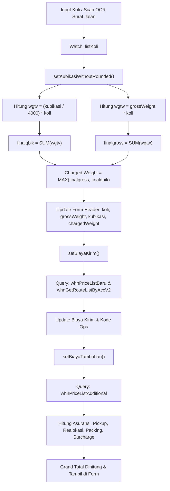

# Dokumentasi Teknis: TTK Corporate Kubikasi (TTKCC2)

> [!NOTE]
> Dokumen ini menjelaskan spesifikasi arsitektur, struktur form, integrasi query database, logika bisnis kalkulasi kubikasi dan biaya tambahan, serta alur data pada halaman [TTKCC2.vue](file:///home/wahyu/project/swb/web/dev/dcaf/src/pages/TTKCC2.vue).

---

## 1. Ringkasan Modul

Modul **TTK Corporate Kubikasi** (`TTKCC2.vue`) merupakan antarmuka Single Page Application (SPA) berbasis Quasar Framework (Vue 2) untuk pencatatan Tanda Terima Kiriman (TTK) pelanggan korporat Wahana Express dengan skema perhitungan berat berbasis kubikasi (*volumetric without rounded*).

Halaman ini merupakan modernisasi dari formulir legasi DCAF/DW:
- **Form Asal**: `form_crud/fnm.50180000ENTBT_m_TTKCC2&notrounded=1`
- **File Komponen**: [TTKCC2.vue](file:///home/wahyu/project/swb/web/dev/dcaf/src/pages/TTKCC2.vue)
- **Karakteristik Utama**:
  - Perhitungan kubikasi menggunakan pembagi korporat (**4000**), bukan retail (6000).
  - Skema multi-koli dengan kemampuan scan OCR surat jalan per koli.
  - Penentuan berat tagihan (*charged weight*) berbasis nilai maksimal antara akumulasi berat kotor dan akumulasi kubikasi.
  - Perhitungan biaya kirim dan biaya tambahan murni 100% dari database via query `whnPriceListAdditional`.

---

## 2. Struktur Antarmuka & Komponen

Halaman dibagi menjadi 2 tab utama yang saling tersinkronisasi secara dua arah (*reactive two-way sync*):

```
+--------------------------------------------------------------------------+
|  [Tab 1: TTK Corporate Kubikasi]   |   [Tab 2: Daftar Koli]              |
+--------------------------------------------------------------------------+
| Tab 1: Form Utama (Header TTK)                                           |
|  - Meta: Ada Packing/Surcharge, Tanggal, Account Korporat, Referensi    |
|  - Kolom Kiri: Layanan, Rekening Bank, Kiriman (Gross, Charged, Koli,   |
|               Volumetrik, Kubikasi, Barang, Harga Barang, Biaya Tambahan)|
|  - Kolom Kanan: Pengirim & Penerima (Asal, Tujuan, Ship-To, Alamat)     |
|  - Bawah: Ringkasan Rincian Biaya & Tombol Simpan                       |
+--------------------------------------------------------------------------+
| Tab 2: Form Detail (Daftar Koli)                                         |
|  - Tabel baris koli: Foto OCR, Koli, Gross Weight, Volumetrik,          |
|    Kubikasi (M³), Checkbox Bubble, Checkbox Kayu, Jenis Barang, Catatan  |
|  - Tombol Tambah Koli, Duplikasi Koli, Hapus Koli                       |
|  - Dialog Scan OCR & Preview Foto Surat Jalan                           |
+--------------------------------------------------------------------------+
```

---

## 3. Integrasi Query Database

Modul ini berinteraksi dengan basis data melalui wrapper query DCAF (`loadQuery`):

| Query / View Name | Fungsi & Parameter | Keterangan |
|---|---|---|
| **`whnPriceListBaru`** / **`whnPriceListNew`** | Menghitung biaya kirim dasar, SLA (*maxtm*), dan kode operasional.<br>Param: `ATRBIID`, `ATRBTP01`, `ATRBTP02`, `ATRBTQTY` | Menggunakan berat kirim final (`chargedWeight`). |
| **`whnGetRouteListByAccV2`** | Mengambil kode rute operasional / Route Code.<br>Param: `ATRBAID`, `ATRBIID`, `ATRBTP01`, `ATRBTP02` | Mengisi kode ops (misal `000` / `JKT-SUB`). |
| **`whnPriceListAdditional`** | Mengambil aturan biaya tambahan murni dari database.<br>Param: `baid` (Account), `biid` (Layanan) | Menghasilkan aturan tarif Asuransi, Pickup, Realokasi, Packing Kayu, Packing Bubble, Surcharge. |
| **`RELBIBT_TTKC`** | Mengambil daftar Layanan yang tersedia untuk Account tertentu.<br>Param: `ATRBAIDP` | Mengisi opsi dropdown Layanan. |
| **`pllvWilayahBEAD`** | Pencarian data wilayah / kota untuk Asal dan Tujuan.<br>Param: `search`, `d-limit` | Digunakan pada autocomplete dan modal lookup. |
| **`pllv_shiptoaddr`** | Daftar alamat tersimpan milik partner korporat (*Ship-To*).<br>Param: `ATRBAIDP` | Mengisi opsi dropdown Ship-To Address. |
| **`RELBEBANKBTP`** | Daftar rekening kas/bank partner korporat.<br>Param: `ATRBAIDP` | Mengisi opsi Rekening Bank Partner. |
| **`RELBABTP_AccountActive`** | Daftar seluruh account aktif korporat.<br>Param: `search` | Mengisi opsi dan modal lookup Account. |
| **`pllv_dokkembali`** | Daftar opsi bukti dokumen kembali (*proof of delivery return*). | Mengisi opsi Dokumen Kembali (TTK/SJ Balik). |

---

## 4. Logika Bisnis & Formula Perhitungan

### 4.1. Formula Kubikasi & Charged Weight (`setKubikasiWithoutRounded`)

Setiap perubahan pada tabel koli (`listKoli`) otomatis memicu method `setKubikasiWithoutRounded`:

1. **Perhitungan per Baris Koli**:
   - `lqbik`: Nilai kubikasi baris koli (atau hasil $P \times L \times T$ jika kubikasi belum diisi manual).
   - Berat volumetrik koli:
     $$\text{wgtv} = \left(\frac{\text{lqbik}}{4000}\right) \times \text{koli}$$
   - Berat kotor baris koli:
     $$\text{wgtw} = \text{grossWeight} \times \text{koli}$$
2. **Akumulasi Total**:
   - $\text{finalgross} = \sum \text{wgtw}$
   - $\text{finalqbik} = \sum \text{wgtv}$
   - $\text{finalkoli} = \sum \text{koli}$
3. **Penentuan Charged Weight**:
   $$\text{Charged Weight} = \max(\text{finalgross}, \text{finalqbik})$$
4. **Output ke Form Header**:
   - `form.koli` $\leftarrow \text{finalkoli}$
   - `form.grossWeight` $\leftarrow \text{finalgross}$
   - `form.kubikasi` $\leftarrow \text{finalqbik}$
   - `form.chargedWeight` $\leftarrow \text{finalqty}$
   - Menjalankan `setBiayaKirim()` untuk memperbarui tarif.

---

### 4.2. Formula Biaya Tambahan (`whnPriceListAdditional`)

Semua biaya tambahan dihitung **100% murni dari database** tanpa nilai fallback hardcode:

```
Aturan Database (whnPriceListAdditional):
- biccd: Kode Biaya (ASVC-INS, ASVC-PIC, ASVC-PKR, ASVC-PKW, ASVC-PKB, ASVC-SCG)
- rangesa: Batas Bawah Rentang
- rangeso: Batas Atas Rentang (-1 jika tak terhingga)
- rangein: Interval Kelipatan (misal per 1 kg)
- val: Nilai Tarif / Koefisien
- minval: Nilai Minimal Biaya
```

#### A. Asuransi (`ASVC-INS`)
- Parameter: `hargaBarang`
- Dihitung jika opsi asuransi dicentang dan `hargaBarang >= 200000`.
$$\text{biaya} = \max\left(\left\lceil\frac{\text{hargaBarang}}{\text{rangein}}\right\rceil \times \text{rangein} \times \text{val},\; \text{minval}\right)$$

#### B. Pickup (`ASVC-PIC`)
- Parameter: `chargedWeight`
- Dihitung jika opsi pickup dicentang.
$$\text{biaya} = \max\left(\left\lceil\frac{\text{chargedWeight}}{\text{rangein}}\right\rceil \times \text{rangein} \times \text{val},\; \text{minval}\right)$$

#### C. Realokasi (`ASVC-PKR` / `ASVC-RLC`)
- Parameter: `chargedWeight`
- Dihitung jika opsi realokasi dicentang.
$$\text{biaya} = \max\left(\left\lceil\frac{\text{chargedWeight}}{\text{rangein}}\right\rceil \times \text{rangein} \times \text{val},\; \text{minval}\right)$$

#### D. Packing Kayu (`ASVC-PKW`)
- Berlaku jika saklar `Ada Packing/Surcharge` aktif.
- Dihitung per koli yang dicentang `isKayu`:
$$\text{biayaKoli} = \text{grossWeightKoli} \times \text{val}$$
$$\text{biayaPackingKayu} = \max\left(\sum \text{biayaKoli},\; \text{minval}\right)$$

#### E. Packing Bubble (`ASVC-PKB`)
- Berlaku jika saklar `Ada Packing/Surcharge` aktif.
- Dihitung per koli yang dicentang `isBubble` berdasarkan total dimensi:
$$\text{volDimensi} = P + L + T$$
$$\text{gwtBubble} = \frac{\text{volDimensi}}{100}$$
$$\text{biayaBubble} = \max\left(\sum (\text{gwtBubble} \times \text{val}),\; \text{minval}\right)$$

#### F. Surcharge Berat Berlebih (`ASVC-SCG`)
- Berlaku jika saklar `Ada Packing/Surcharge` aktif.
- Dihitung per koli yang memiliki berat per unit $> 50$ KG:
$$\text{biayaSurcharge} = \max\left(\sum \left(\left\lceil\frac{\text{gwtItem}}{\text{rangein}}\right\rceil \times \text{rangein} \times \text{val} \times \text{biayaPerKg} \times \text{koli}\right),\; \text{minval}\right)$$

---

### 4.3. Grand Total Biaya

Total akhir dihitung melalui penjumlahan komponen:
$$\text{Total} = \text{Biaya Kirim} + \text{Packing Kayu} + \text{Packing Bubble} + \text{Surcharge} + \text{Asuransi} + \text{Pickup} + \text{Realokasi} - \text{Diskon}$$

---

## 5. Diagram Alur Data (Data Flow)



---

## 6. Panduan Pemeliharaan & Troubleshooting

1. **Hasil Biaya Tambahan Bernilai 0**:
   - Pastikan akun partner memiliki relasi aturan di tabel `whnPriceListAdditional`.
   - Modul ini tidak lagi menggunakan nilai fallback manual. Jika query tidak mengembalikan data untuk kode biaya yang bersangkutan, nilai otomatis diset 0.
2. **Perubahan Rumus Kubikasi**:
   - Jika ada kebutuhan penyesuaian faktor pembagi kubikasi, periksa method `setKubikasiWithoutRounded` baris 2814 (`wgtv = (lqbik / 4000) * koli`).
3. **Penyimpanan TTK Baru**:
   - Payload simpan dikirim ke endpoint controller backend `whnSaveTTKCorporate` melalui method `simpanData()`.
   - Pastikan field wajib (*mandatory*) terisi: Tanggal, Account, Gross Weight, Tujuan, dan Biaya Tambahan.
