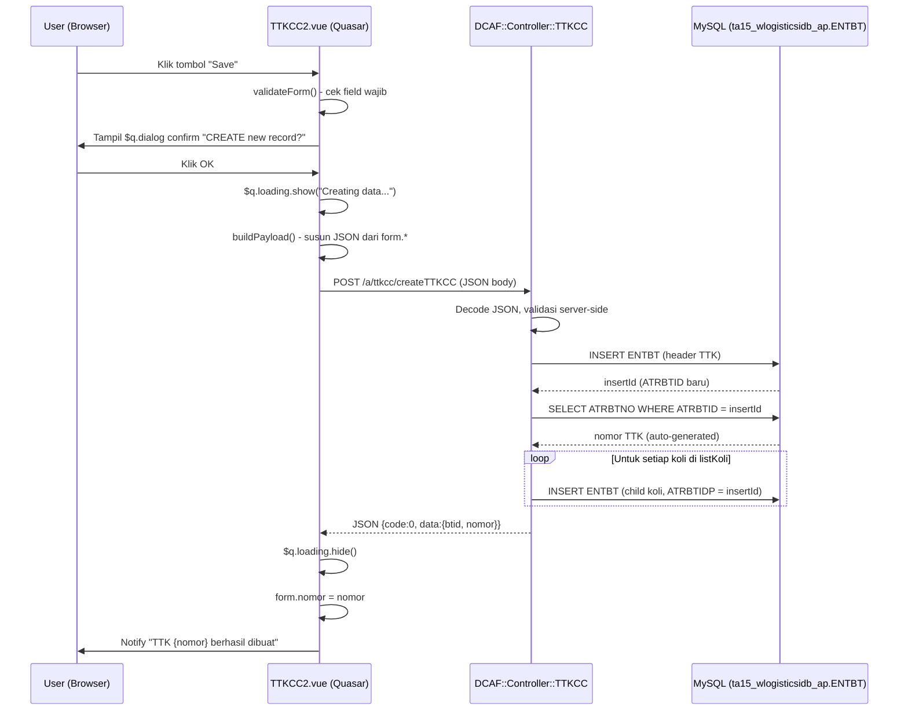

# Analisis: Flow Save TTKCC (Sandbox) vs Blueprint TTKCC2 (SWB)

> [!IMPORTANT]
> Dokumen ini bersifat ANALISIS SAJA. Belum ada kode yang ditulis. Tujuan: memahami penuh flow save TTKCC lama, lalu merencanakan cara implementasi yang sama di TTKCC2 dalam arsitektur SWB (Quasar + DCAF Perl).

---

## 1. Konteks: Dua Sistem yang Berbeda

| Aspek | TTKCC (Sandbox, lama) | TTKCC2 (SWB, baru) |
|-------|-----------------------|--------------------|
| URL | `sandbox.wahana.com:82/apps/wahana/cgi-bin/dw.cgi?b=form_crud/fnm.50180000ENTBT_m_TTKCC2` | SWB Quasar SPA |
| Framework FE | Server-rendered HTML + jQuery (`ui.js`) | Vue 2 + Quasar |
| Framework BE | DW (DataWizard) — Perl CGI lama | DCAF — Perl uWSGI/Plack modern |
| Submit | HTML `<form>` POST via DW CRUD engine | Axios JSON POST ke DCAF Controller |
| Konfirmasi | Native `window.confirm()` browser | Quasar `$q.dialog()` |
| Loading | `waitingDialog.show("Creating data...")` | Quasar loading / spinner |

---

## 2. Flow Save TTKCC (Sistem Lama) — Step by Step

### 2.1 Alur Pengguna (dari screenshot)

```
[User isi form]
      |
      v
[Klik tombol "Save" (hijau, kanan atas)]
      |
      v
[Browser menampilkan native confirm dialog]
   "Are you sure to CREATE new record?"
      |
     [OK]
      |
      v
[Loading overlay muncul: "Creating data..." + progress bar]
      |
      v
[Request dikirim ke server]
      |
      v
[Response diterima -> redirect ke URL dengan ATRBTYID, ATRBTP03, ATRBTP04]
```

### 2.2 URL setelah save berhasil (dari screenshot bar browser)
```
form_crud/fnm.50180000ENTBT_m_TTKCC2
  &ATRBTYID=5001
  &ATRBTP03=...
  &ATRBTP04=...
  (parameter tambahan lain)
```
Ini artinya DW engine melakukan **redirect ke form yang sama tapi dalam mode EDIT/VIEW** dengan ID yang baru dibuat.

---

## 3. Mekanisme DW form_crud (Backend Lama)

URL yang dipakai TTKCC lama adalah:
```
/apps/wahana/cgi-bin/dw.cgi?b=form_crud/fnm.50180000ENTBT_m_TTKCC2
```

### 3.1 Komponen URL
| Bagian | Nilai | Arti |
|--------|-------|------|
| `b` | `form_crud/fnm.50180000ENTBT_m_TTKCC2` | Instruksi DW: render form CRUD untuk entity `50180000ENTBT`, modul `m_TTKCC2` |
| `ENTBT` | Entity/tabel utama | Business Transaction |
| `50180000` | Kode form/module prefix | Nomor form dalam DW |
| `m_TTKCC2` | Modul tambahan | TTKCC versi 2 (di DW) |

### 3.2 Yang Terjadi Saat Submit (DW engine)
1. DW engine membaca definisi form dari database (tabel `ENTF` atau sejenisnya)
2. Membaca semua `<input>` pada HTML form
3. Memetakan field HTML ke kolom database (`ATRBTDT` → tanggal, `ATRBAIDP` → account ID, dst.)
4. Mengeksekusi query INSERT ke tabel `ENTBT` di database produksi (db `ta15_wlogisticsidb_ap`)
5. Nomor TTK di-generate otomatis (`[AUTO]` → nomor running sequence)
6. Redirect ke halaman yang sama dalam mode view dengan ID baru

### 3.3 Kolom ENTBT yang Disimpan (dari `waxGetConsignment` query)
```sql
-- Kolom utama yang diisi saat create TTKCC:
ATRBTTYID = 5001           -- Type ID untuk TTK Corporate Kubikasi
ATRBTDT   = tanggal form   -- Tanggal
ATRBAIDP  = ID account     -- Account (partner pengirim)
ATRBIID   = ID layanan     -- Layanan (service)
ATRBTP01  = ID wilayah asal   -- Asal
ATRBTP02  = ID wilayah tujuan -- Tujuan
ATRBTNO   = nomor TTK AUTO    -- Nomor (auto-generated)
ATRBTSS   = 1              -- Status awal (1 = baru/created)
ATRBTP03  = nama penerima  -- Nama
ATRBTP04  = telepon penerima -- Telepon
ATRBTP05  = kode ops       -- Kode Ops
ATRBTP06  = nama penerima (di DW ini berbeda field)
ATRBTP07  = telepon penerima
ATRBTP08  = alamat penerima
ATRBTP09  = kode ops route -- Route code (dari pricing engine)
ATRBTP11  = gross weight   -- Berat kotor (KG)
ATRBTP12  = dimensi (volumetrik PPPxLLLxTTT) -- Dimension CM3
ATRBTP13  = deskripsi barang
ATRBTP14  = harga barang   -- Nilai barang (untuk asuransi)
ATRBTP15  = biaya asuransi
ATRBTP16  = jumlah koli    -- Bag count
ATRBTP17  = lead time (hari)
ATRBTQTY  = charged weight / nett weight
ATRBTVALU = biaya kirim (tanpa asuransi)
ATRBTVAL  = total biaya (biaya kirim + asuransi)
ATRBTP30  = biaya kirim per KG (tarif dasar)
```

### 3.4 Pricing Engine (Bagian Kritis!)
Sebelum save, `setBiayaKirim(fnm)` di `ui.js` dipanggil:

```javascript
// ui.js baris ~490-708
function setBiayaKirim(fnm) {
    // 1. Ambil parameter
    var parameter = {
        ATRBIID: ...,   // ID layanan
        ATRBTP01: ...,  // ID asal
        ATRBTP02: ...,  // ID tujuan
        ATRBTQTY: ...,  // berat
        b: 'view/vnm.whnPriceList+lo.xml'
    };

    // 2. POST ke pricing engine
    var posting = $.post(apburl + "/cgi-bin/dw.cgi", parameter);

    // 3. Parse XML response
    posting.done(function(data) {
        var kodeops    = $xml.find("kodeops").text();
        var biayaperkg = $xml.find("biaya").text();
        var maxtm      = $xml.find("maxtm").text();

        // 4. Hitung biaya
        var biaya       = berat * biayaperkg;
        var asuransi    = Math.ceil(harga * (0.5/100.0));
        var totalbiaya  = biaya + asuransi;

        // 5. Isi field hidden di form
        $(form + " input#ATRBTP30").val(biayaperkg);  // tarif per kg
        $(form + " input#ATRBTVALU").val(biaya);       // biaya kirim
        $(form + " input#ATRBTP09").val(kodeops);      // kode ops
        $(form + " input#ATRBTVAL").val(totalbiaya);   // total
        $(form + " input#ATRBTP17").val(maxtm);        // lead time
    });
}
```

> [!NOTE]
> Di **TTKCC2 SWB** sudah ada logic ini! Di method `hitungTarif()` / `hitungHarga()` yang memanggil query `whnPriceListBaru` dan `whnGetRouteListByAccV2`. Sudah cukup lengkap - tinggal dipastikan nilainya masuk ke `form.*` sebelum di-submit.

---

## 4. Data yang Sudah Ada di TTKCC2 Sekarang

Dari analisis [`TTKCC2.vue`](file:///home/joan/codes/swb/web/dev/dcaf/src/pages/TTKCC2.vue), semua data form sudah tersedia di state `form`:

```javascript
// State form yang sudah ada di TTKCC2.vue
form: {
    adaPacking:        // Ada Packing/Surcharge (Ya/Tidak)
    tanggal:           // Tanggal
    nomor:             // [AUTO]
    account:           // Object {id, sid, code, name, label}
    layanan:           // ID layanan (ATRBIID)
    referensi:         // Nomor referensi manual
    printer:           // Jenis printer
    buktiKembali:      // Array checkbox
    grossWeight:       // Berat kotor KG (ATRBTP11)
    chargedWeight:     // Charged weight (ATRBTQTY)
    koli:              // Jumlah koli (ATRBTP16)
    volumetrik:        // PPPxLLLxTTT (ATRBTP12)
    kubikasi:          // M3
    barang:            // Jenis barang (ATRBTP13)
    hargaBarang:       // Harga barang (ATRBTP14)
    biayaTambahan:     // Array checkbox
    asal:              // Object {label, value} -> value = ATRBTP01
    tujuan:            // Object {label, value} -> value = ATRBTP02
    kodeOps:           // Kode Ops (ATRBTP09)
    namaPenerima:      // Nama penerima (ATRBTP03/06)
    teleponPenerima:   // Telepon (ATRBTP04/07)
    alamatPenerima:    // Alamat (ATRBTP08)
    biayaKirimPerKg:   // Tarif per KG (ATRBTP30)
    biayaKirim:        // Biaya kirim (ATRBTVALU)
    biayaRealokasi:    // Biaya realokasi (ATRBTP27)
    biayaPickup:       // Biaya pickup (ATRBTP28)
    biayaAsuransi:     // Biaya asuransi (ATRBTP15)
    biayaPacking:      // Biaya packing
    packingBubble:     // Packing bubble
    biayaSurcharge:    // Biaya surcharge
    biayaDiskon:       // Biaya diskon
    total:             // Total biaya (ATRBTVAL)
    catatan:           // Catatan (ATRBTP05)
    supplier:          // ID supplier/penerima
    shipTo:            // Ship-To address
    bankPartner:       // Rekening bank partner
}

// Detail koli (tab Daftar Koli)
listKoli: [
    {
        foto:            // base64 foto (tidak disimpan ke DB main, terpisah)
        koli:            // jumlah koli di baris ini
        grossWeight:     // berat kotor per koli
        volumetrik:      // dimensi per koli
        kubikasi:        // kubikasi per koli
        isBubble:        // packing bubble?
        isKayu:          // packing kayu?
        jenisBarang:     // nama barang
        catatan:         // catatan koli
        beratSurcharge:  // berat surcharge (auto-hitung)
        biayaSurcharge:  // biaya surcharge (auto-hitung)
        biayaPacking:    // biaya packing kayu (auto-hitung)
        biayaPackingBubble: // biaya packing bubble (auto-hitung)
    }
]
```

---

## 5. Yang BELUM Ada di TTKCC2 (Harus Dibuat)

### 5.1 Tombol Save
Belum ada tombol Save di TTKCC2! Di TTKCC lama ada tombol hijau "Save" di kanan atas header.

### 5.2 Method `simpanData()` / `handleSave()`
Belum ada logic submit form ke backend.

### 5.3 Backend Controller
Belum ada `DCAF::Controller::TTKCC` atau sejenisnya dengan operation `createTTKCC`.

### 5.4 Database Query
Belum ada query INSERT ke `ENTBT` untuk TTKCC2 di SWB.

### 5.5 Validasi Sebelum Save
Belum ada validasi mandatory fields sebelum submit.

---

## 6. Blueprint: Cara Implementasi Save di TTKCC2

### 6.1 Layer Frontend (Vue 2 / Quasar)

**Tambahkan tombol Save di toolbar:**
```html
<!-- Di TTKCC2.vue template, header area -->
<q-btn
  color="positive"
  label="Save"
  icon="save"
  :loading="isSaving"
  @click="handleSave"
/>
```

**Method `handleSave()`:**
```javascript
async handleSave () {
    // 1. Validasi mandatory fields
    if (!this.validateForm()) return

    // 2. Konfirmasi
    const ok = await new Promise(resolve => {
        this.$q.dialog({
            title: 'Konfirmasi',
            message: 'Are you sure to CREATE new record?',
            cancel: true,
            ok: 'OK'
        }).onOk(() => resolve(true)).onCancel(() => resolve(false))
    })
    if (!ok) return

    // 3. Set loading
    this.isSaving = true
    this.$q.loading.show({ message: 'Creating data...' })

    try {
        // 4. Susun payload
        const payload = this.buildPayload()

        // 5. POST ke backend DCAF
        const res = await this.$axios.post('/a/ttkcc/createTTKCC', payload)

        if (res.data.code === 0) {
            // 6. Success
            const nomor = res.data.data.nomor
            this.form.nomor = nomor
            this.$q.notify({ type: 'positive', message: `TTK ${nomor} berhasil dibuat` })
            // Optionally reload or redirect
        } else {
            this.$q.notify({ type: 'negative', message: res.data.message })
        }
    } catch (err) {
        this.$q.notify({ type: 'negative', message: 'Gagal menyimpan data: ' + err.message })
    } finally {
        this.isSaving = false
        this.$q.loading.hide()
    }
},

buildPayload () {
    const f = this.form
    return {
        // Header
        tanggal:        f.tanggal,
        accountId:      typeof f.account === 'object' ? f.account.id : f.account,
        layananId:      f.layanan,
        referensi:      f.referensi,
        adaPacking:     f.adaPacking,
        printer:        f.printer,
        buktiKembali:   f.buktiKembali,

        // Kiriman
        grossWeight:    f.grossWeight,
        chargedWeight:  f.chargedWeight,
        koli:           f.koli,
        volumetrik:     f.volumetrik,
        kubikasi:       f.kubikasi,
        barang:         f.barang,
        hargaBarang:    f.hargaBarang,
        biayaTambahan:  f.biayaTambahan,

        // Pengiriman
        asalId:         typeof f.asal === 'object' ? f.asal.value : f.asal,
        tujuanId:       typeof f.tujuan === 'object' ? f.tujuan.value : f.tujuan,
        kodeOps:        f.kodeOps,
        namaPenerima:   f.namaPenerima,
        telepon:        f.teleponPenerima,
        alamat:         f.alamatPenerima,
        supplierId:     f.supplier,

        // Biaya (sudah dihitung oleh pricing engine)
        biayaKirimPerKg: f.biayaKirimPerKg,
        biayaKirim:     f.biayaKirim,
        biayaAsuransi:  f.biayaAsuransi,
        biayaRealokasi: f.biayaRealokasi,
        biayaPickup:    f.biayaPickup,
        biayaPacking:   f.biayaPacking,
        biayaSurcharge: f.biayaSurcharge,
        biayaDiskon:    f.biayaDiskon,
        total:          f.total,
        catatan:        f.catatan,

        // Detail koli
        listKoli: this.listKoli.map(k => ({
            koli:              k.koli,
            grossWeight:       k.grossWeight,
            volumetrik:        k.volumetrik,
            kubikasi:          k.kubikasi,
            isBubble:          k.isBubble,
            isKayu:            k.isKayu,
            jenisBarang:       k.jenisBarang,
            catatan:           k.catatan,
            beratSurcharge:    k.beratSurcharge,
            biayaSurcharge:    k.biayaSurcharge,
            biayaPacking:      k.biayaPacking,
            biayaPackingBubble: k.biayaPackingBubble
            // foto: k.foto  <-- pisahkan upload foto ke endpoint terpisah
        }))
    }
},

validateForm () {
    const f = this.form
    const errors = []
    if (!f.account)       errors.push('Account harus diisi')
    if (!f.layanan)       errors.push('Layanan harus dipilih')
    if (!f.asal)          errors.push('Wilayah Asal harus diisi')
    if (!f.tujuan)        errors.push('Wilayah Tujuan harus diisi')
    if (!f.grossWeight)   errors.push('Gross Weight harus diisi')
    if (!f.koli)          errors.push('Koli harus diisi')
    if (!f.namaPenerima)  errors.push('Nama Penerima harus diisi')
    if (!f.alamatPenerima) errors.push('Alamat harus diisi')
    if (!f.total)         errors.push('Total biaya belum dihitung (lengkapi data tarif)')

    if (errors.length) {
        this.$q.dialog({
            title: 'Data belum lengkap',
            message: errors.join('<br>'),
            html: true
        })
        return false
    }
    return true
}
```

### 6.2 Layer Backend (DCAF Perl Controller)

**File baru: `lib/perl/DCAF/Controller/TTKCC.pm`**

```perl
package DCAF::Controller::TTKCC;

use strict;
use parent 'DCAF::Controller';
use DCAF::Query;

sub new {
    my ($roc, %ha) = @_;
    my $ros = $roc->SUPER::new(%ha);
    bless $ros, $roc;
    $ros->{className} = ref($ros);
    return $ros;
}

sub run {
    my ($ros) = @_;
    $ros->log('SA');

    my $rhcp = $DCAF::ros->{json}->decode($ros->{q}->{q}->content || '{}');

    switch: {
        $ros->{api}->{operation} eq 'createTTKCC' && do {
            # Validasi mandatory
            unless ($rhcp->{accountId} && $rhcp->{layananId} && $rhcp->{asalId}
                 && $rhcp->{tujuanId} && $rhcp->{grossWeight} && $rhcp->{namaPenerima}) {
                $ros->{q}->{e}->{status} = 400;
                $ros->{q}->{e}->{num}    = "$ros->{className}/createTTKCC/01";
                $ros->{q}->{e}->{msg}    = 'Missing required fields';
                die;
            }

            # INSERT ke ENTBT (query name: ttkccCreateEntbt)
            my $roq = DCAF::Query->new(
                q    => $ros->{q},
                name => 'ttkccCreateEntbt',
                data => {
                    tanggal      => $rhcp->{tanggal},
                    accountId    => $rhcp->{accountId},
                    layananId    => $rhcp->{layananId},
                    asalId       => $rhcp->{asalId},
                    tujuanId     => $rhcp->{tujuanId},
                    grossWeight  => $rhcp->{grossWeight},
                    chargedWeight => $rhcp->{chargedWeight},
                    koli         => $rhcp->{koli},
                    volumetrik   => $rhcp->{volumetrik},
                    kubikasi     => $rhcp->{kubikasi},
                    barang       => $rhcp->{barang},
                    hargaBarang  => $rhcp->{hargaBarang},
                    namaPenerima => $rhcp->{namaPenerima},
                    telepon      => $rhcp->{telepon},
                    alamat       => $rhcp->{alamat},
                    kodeOps      => $rhcp->{kodeOps},
                    biayaKirimPerKg => $rhcp->{biayaKirimPerKg},
                    biayaKirim   => $rhcp->{biayaKirim},
                    biayaAsuransi => $rhcp->{biayaAsuransi},
                    total        => $rhcp->{total},
                    catatan      => $rhcp->{catatan},
                    # ... field lainnya
                }
            );
            $roq->run || die;

            unless ($roq->{result}->{rows}) {
                $ros->{q}->{e}->{status} = 500;
                $ros->{q}->{e}->{num}    = "$ros->{className}/createTTKCC/02";
                $ros->{q}->{e}->{msg}    = 'Gagal menyimpan data TTK';
                die;
            }

            my $newBtid = $roq->{result}->{insertId};

            # Ambil nomor TTK yang di-generate
            my $rhres = {};
            $ros->q2j('ttkccGetNomorByBtid', { btid => $newBtid }, { hashed => 1 }, $rhres);
            my $rhttk = shift @{$rhres->{result}->{body}};

            # INSERT koli detail (loop)
            if ($rhcp->{listKoli} && ref($rhcp->{listKoli}) eq 'ARRAY') {
                foreach my $rhkoli (@{$rhcp->{listKoli}}) {
                    my $roqk = DCAF::Query->new(
                        q    => $ros->{q},
                        name => 'ttkccCreateEntbtKoli',
                        data => {
                            parentBtid => $newBtid,
                            btno       => $rhttk->{nomor},
                            koli       => $rhkoli->{koli},
                            grossWeight => $rhkoli->{grossWeight},
                            volumetrik  => $rhkoli->{volumetrik},
                            # ... field koli lainnya
                        }
                    );
                    $roqk->run || die;
                }
            }

            $ros->{templateData}->{jstext} = $DCAF::ros->{json}->encode({
                code    => 0,
                status  => 'success',
                message => 'TTK berhasil dibuat',
                data    => {
                    btid  => $newBtid,
                    nomor => $rhttk->{nomor}
                }
            });
            last switch;
        };

        # Default
        $ros->{templateData}->{jstext} = $DCAF::ros->{json}->encode({
            code    => 1,
            status  => 'failed',
            message => 'Unhandled request'
        });
    }

    $ros->log('SO');
    $ros->render || die;
    return 1;
}

1;
```

### 6.3 Layer Database (SQL Queries)

**Query INSERT header TTK:**
```sql
-- Query name: ttkccCreateEntbt
-- Params: tanggal, accountId, layananId, asalId, tujuanId, 
--         grossWeight, chargedWeight, koli, volumetrik, kubikasi,
--         barang, hargaBarang, namaPenerima, telepon, alamat,
--         kodeOps, biayaKirimPerKg, biayaKirim, biayaAsuransi, total, catatan

INSERT INTO ta15_wlogisticsidb_ap.ENTBT
SET
  ATRBTTYID = 5001,              -- Type: TTK Corporate Kubikasi
  ATRBTDT   = ?,                 -- tanggal
  ATRBAIDP  = ?,                 -- accountId
  ATRBIID   = ?,                 -- layananId
  ATRBTP01  = ?,                 -- asalId (wilayah asal)
  ATRBTP02  = ?,                 -- tujuanId (wilayah tujuan)
  ATRBTSS   = 1,                 -- status: baru
  ATRBTP11  = ?,                 -- grossWeight
  ATRBTQTY  = ?,                 -- chargedWeight
  ATRBTP16  = ?,                 -- koli
  ATRBTP12  = ?,                 -- volumetrik (dimensi)
  ATRBTP13  = ?,                 -- barang (deskripsi)
  ATRBTP14  = ?,                 -- hargaBarang
  ATRBTP03  = ?,                 -- namaPenerima (sender/pengirim di DW = nama di penerima)
  ATRBTP06  = ?,                 -- namaPenerima (penerima)
  ATRBTP07  = ?,                 -- telepon
  ATRBTP08  = ?,                 -- alamat
  ATRBTP09  = ?,                 -- kodeOps
  ATRBTP30  = ?,                 -- biayaKirimPerKg
  ATRBTVALU = ?,                 -- biayaKirim
  ATRBTP15  = ?,                 -- biayaAsuransi
  ATRBTVAL  = ?,                 -- total
  ATRBTP05  = ?,                 -- catatan
  ATRBTDTP  = now()              -- posting date
```

**Query INSERT koli detail:**
```sql
-- Query name: ttkccCreateEntbtKoli
-- Mirip drpInsertChildBTMultiKoli yang sudah ada
INSERT INTO ta15_wlogisticsidb_ap.ENTBT
SET
  ATRBTTYID = 5001,
  ATRBTIDP  = ?,    -- parentBtid
  ATRBTP11  = ?,    -- grossWeight per koli
  ATRBTP12  = ?,    -- volumetrik per koli
  ATRBTQTY  = ?,    -- koli count
  ATRBTNO   = ?     -- nomor ttk induk
```

**Query ambil nomor TTK baru:**
```sql
-- Query name: ttkccGetNomorByBtid
SELECT ATRBTNO nomor, ATRBTID btid
FROM ta15_wlogisticsidb_ap.ENTBT
WHERE ATRBTID = ?
```

### 6.4 OpenAPI Doc

**File: `etc/api/ttkcc.yaml`**
```yaml
# dcaf:01
openapi: 3.0.0
info:
  version: 1.0.0
  title: TTKCC
  description: TTK Corporate Kubikasi API
paths:
  /createTTKCC:
    post:
      tags:
        - TTKCC
      summary: Create new TTK Corporate Kubikasi
      operationId: createTTKCC/TTKCC
      security:
        - bearer: []
      requestBody:
        required: true
        content:
          application/json:
            schema:
              type: object
              required: [tanggal, accountId, layananId, asalId, tujuanId, namaPenerima, alamatPenerima]
              properties:
                tanggal:
                  type: string
                  format: date
                accountId:
                  type: integer
                layananId:
                  type: integer
                # ... (field lainnya)
      responses:
        200:
          description: Successful
          content:
            application/json:
              schema:
                type: object
                properties:
                  code:
                    type: integer
                  data:
                    type: object
                    properties:
                      btid:
                        type: integer
                      nomor:
                        type: string
```

### 6.5 Registrasi di `etc/dcaf.yaml`

```yaml
api:
  # ... existing entries
  ttkcc: /etc/api/ttkcc.yaml   # tambahkan ini
```

---

## 7. Pemetaan Field Form -> Kolom ENTBT

| Field di TTKCC2 Vue | Kolom ENTBT | Keterangan |
|---------------------|-------------|------------|
| `form.tanggal` | `ATRBTDT` | Tanggal |
| `form.account.id` | `ATRBAIDP` | ID Account (ENTBA.ATRBAID) |
| `form.layanan` | `ATRBIID` | ID Layanan (ENTBI.ATRBIID) |
| `form.asal.value` | `ATRBTP01` | ID Wilayah Asal (ENTCAREA) |
| `form.tujuan.value` | `ATRBTP02` | ID Wilayah Tujuan (ENTCAREA) |
| `form.grossWeight` | `ATRBTP11` | Gross Weight KG |
| `form.chargedWeight` | `ATRBTQTY` | Charged/Nett Weight |
| `form.koli` | `ATRBTP16` | Jumlah Koli |
| `form.volumetrik` | `ATRBTP12` | Dimensi (PPP x LLL x TTT) |
| `form.barang` | `ATRBTP13` | Deskripsi Barang |
| `form.hargaBarang` | `ATRBTP14` | Harga Barang (nilai) |
| `form.namaPenerima` | `ATRBTP03` / `ATRBTP06` | Nama Penerima |
| `form.teleponPenerima` | `ATRBTP04` / `ATRBTP07` | Telepon Penerima |
| `form.alamatPenerima` | `ATRBTP08` | Alamat Penerima |
| `form.kodeOps` | `ATRBTP09` | Kode Ops/Route |
| `form.biayaKirimPerKg` | `ATRBTP30` | Tarif per KG |
| `form.biayaKirim` | `ATRBTVALU` | Biaya Kirim |
| `form.biayaAsuransi` | `ATRBTP15` | Biaya Asuransi |
| `form.biayaRealokasi` | `ATRBTP27` | Biaya Realokasi |
| `form.biayaPickup` | `ATRBTP28` | Biaya Pickup |
| `form.total` | `ATRBTVAL` | Total Biaya |
| `form.catatan` | `ATRBTP05` | Catatan |
| (hardcoded) | `ATRBTTYID = 5001` | Type TTK Corp Kubikasi |
| (hardcoded) | `ATRBTSS = 1` | Status: Baru |

---

## 8. Hal Kritis yang Perlu Dicek Sebelum Implementasi

> [!WARNING]
> Sebelum implement save, verifikasi dulu hal-hal berikut:

1. **Database akses**: Apakah DCAF SWB punya koneksi ke `ta15_wlogisticsidb_ap` (database produksi TTK)? Atau pakai DB yang berbeda?
2. **Nomor TTK auto-generate**: Di DW lama, nomor di-generate oleh sistem DW sendiri. Di SWB, perlu cek apakah ada stored procedure atau sequence untuk generate nomor TTK Corporate.
3. **Kolom ATRBTP03 vs ATRBTP06**: Di query `waxGetConsignment`, ada `sender.name = ATRBTP03` dan `receiver.name = ATRBTP06`. Perlu dipastikan mana yang sebenarnya "penerima" vs "pengirim" di konteks TTKCC.
4. **Multi-koli vs single row**: Di TTKCC2 ada `listKoli` (tabel detail). Di DW lama, koli detail mungkin satu row atau multi-row child. Perlu cek query `drpInsertChildBTMultiKoli` yang sudah ada.
5. **Foto koli**: Di TTKCC2 ada fitur kamera/foto per koli. Foto ini sebaiknya diupload terpisah (endpoint upload) setelah save, bukan dimasukkan ke ENTBT sebagai blob.
6. **Field tambahan**: `buktiKembali`, `adaPacking`, `printer`, `biayaTambahan` - perlu mapping ke kolom ENTBT yang tepat.
7. **Referensi**: `form.referensi` belum jelas mapping-nya ke kolom apa.

---

## 9. Diagram Alur Lengkap



---

## 10. Ringkasan: Perbedaan Kunci

| Aspek | TTKCC (DW lama) | TTKCC2 (SWB baru) |
|-------|-----------------|-------------------|
| Trigger Save | Klik `<button type="submit">` | Klik `q-btn @click="handleSave"` |
| Konfirmasi | `window.confirm()` | `this.$q.dialog()` |
| Loading | `waitingDialog.show()` | `this.$q.loading.show()` |
| Submit | HTML form POST via DW CRUD engine | `this.$axios.post('/a/ttkcc/createTTKCC', payload)` |
| Pricing | `setBiayaKirim()` panggil DW pricing XML | `hitungTarif()` / `hitungHarga()` via query `whnPriceListBaru` (sudah ada di TTKCC2) |
| Backend | DW auto-mapping form fields ke DB | DCAF Controller mapping manual JSON ke DB query |
| DB Write | DW langsung INSERT via form mapping | DCAF `DCAF::Query->new(name=>'ttkccCreateEntbt')` |
| Nomor TTK | DW auto-generate | Perlu dipastikan mekanisme generate di SWB |
| Multi-koli | Tabel koli terpisah via DW | Loop INSERT per baris `listKoli` |
| Redirect | Redirect ke form edit | Tetap di halaman yang sama, update `form.nomor` |
