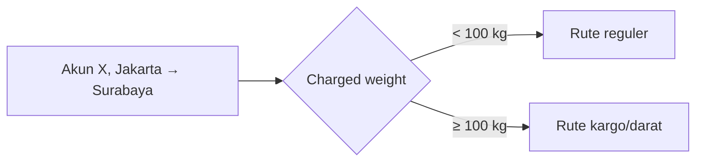

# 📦 TTKCC2 — Changelog Kalkulasi Tarif & Biaya Tambahan

> **Branch:** `TTKCC2-FZ` · **File terdampak:** `web/dev/dcaf/src/pages/TTKCC2.vue`
> **Rentang commit:** `e6168b05` → `33db7799` (termasuk `07e5afb5` yang masuk lewat merge)

## Ringkasan 
| # | Commit | Perubahan singkat | Dampak bisnis |
|---|--------|-------------------|---------------|
| 1 | `07e5afb5` + merge `eaaf7af9` | Kubikasi terisi otomatis dari hasil scan OCR surat jalan | Input lebih cepat, salah ketik berkurang |
| 2 | `e6168b05` | Tarif & biaya tambahan diambil dari database | Harga mengikuti master tarif, tidak lagi angka tetap di kode |
| 3 | `2cd9f93c` | Rute (kode ops) khusus akun kini mempertimbangkan berat | Akun dengan rute berbeda per tier berat terlayani dengan benar |
| 4 | `33db7799` | Packing kayu, bubble & surcharge berat ikut aturan database | Biaya packing konsisten dengan kebijakan tarif per akun/layanan |

### Alur kalkulasi setelah semua perubahan

  ```mermaid
  flowchart TD
      A[Scan OCR surat jalan] -->|autofill kubikasi| B[Daftar Koli]
      B --> C[Hitung Charged Weight]
      C --> D[whnGetRouteListByAccV2<br/>rute akun + tier berat]
      D -->|tidak ada| E[Fallback whnPriceListBaru<br/>rute standar]
      D --> F[whnPriceListBaru<br/>biaya kirim]
      E --> F
      F --> G[whnPriceListAdditional<br/>aturan biaya tambahan per akun & layanan]
      G --> H1[Asuransi ASVC-INS]
      G --> H2[Pickup ASVC-PIC]
      G --> H3[Realokasi ASVC-PKR/RLC]
      G --> H4{Ada Packing?}
      H4 -->|Ya| P1[Kayu ASVC-PKW]
      H4 -->|Ya| P2[Bubble ASVC-PKB]
      H4 -->|Ya| P3[Surcharge ASVC-SCG]
      H1 & H2 & H3 & P1 & P2 & P3 --> T[Total Biaya]
  ```

---

## 1. Autofill Kubikasi dari OCR — `07e5afb5` (via merge `eaaf7af9`)

**Kondisi awal:** Hasil scan OCR sudah membaca surat jalan, tapi kolom kubikasi di daftar koli masih diisi manual. Koli tambahan (multi-koli) juga tidak ikut terisi.

**Masalah:** Petugas mengetik ulang angka yang sebenarnya sudah ada di dokumen. Rumus kubikasi & charged weight di halaman ini juga belum sama dengan `ui.js` (aplikasi lama), jadi hasilnya bisa berbeda.

**Solusi:**
- Kubikasi diambil dari kolom `volume_cm3` surat jalan, sesuai angka di dokumen.
- Berlaku juga untuk setiap baris koli tambahan.
- Rumus kubikasi & charged weight disamakan dengan `ui.js`.
- Kubikasi di header ditampilkan sampai 6 desimal supaya tidak ada pembulatan yang menyesatkan.

---

## 2. Integrasi Query Tarif & Biaya Tambahan — `e6168b05`

**Kondisi awal:**
- Biaya kirim diambil dari query `whnPriceListNew` dengan parameter ganda (`berat`, `biid`, `btp01`… dan `ATRB*`).
- Asuransi, pickup, dan realokasi dihitung dengan **rumus hardcode** di frontend (misal asuransi = 0,2% harga barang, minimal 5.000).
- `setBiayaTambahan()` dipanggil tanpa `await`, dan `setBiayaAsuransi()` dipanggil dua kali saat harga barang berubah.

**Masalah:** Kalau tarif di database berubah atau tiap akun punya tarif berbeda, frontend tetap memakai angka lama. Karena urutan pemanggilan tidak ditunggu (`await`), total biaya bisa dihitung sebelum biaya kirim selesai dimuat.

**Solusi:**
- Ganti ke query `whnPriceListBaru` yang hanya memakai parameter `ATRB*`.
- `setBiayaTambahan()` dibuat `async` dan **selalu** memanggil `whnPriceListAdditional` (`baid` = akun, `biid` = layanan).
- Asuransi/pickup/realokasi membaca aturan dari database (`ASVC-INS`, `ASVC-PIC`, `ASVC-PKR`/`ASVC-RLC`): rentang (`rangesa`–`rangeso`), kelipatan (`rangein`), tarif (`val`), dan minimum (`minval`). Rumus lama masih dipakai sebagai cadangan (fallback).
- Pemanggilan ganda asuransi dihapus.

**Contoh kasus (ilustrasi):** Harga barang Rp1.000.000, aturan DB `ASVC-INS` tarif 0,3 dan minimum 5.000.
- Sebelum: `max(1.000.000 × 0,2%, 5.000)` = **Rp5.000** (selalu sama untuk semua akun)
- Sesudah: `1.000.000 × 0,3%` = 3.000 → di bawah minimum → **Rp5.000**. Kalau akun lain punya tarif 0,5%, hasilnya **Rp5.000** juga, tapi untuk harga Rp5.000.000 hasilnya jadi Rp25.000 sesuai tarif masing-masing akun.

---

## 3. Rute Kode Ops Berbasis Berat — `2cd9f93c`

**Kondisi awal:** Rute khusus akun diambil dari `whnGetRouteListByAcc` tanpa informasi berat.

**Masalah:** Sebagian akun punya rute berbeda tergantung berat kiriman (tier). Tanpa berat, sistem selalu mengembalikan rute yang sama.

**Solusi:** Pindah ke `whnGetRouteListByAccV2` dan kirim `ATRBTQTY` = charged weight.



*Contoh tier di atas hanya ilustrasi. Batas sebenarnya diatur di database.*

---

## 4. Packing Kayu, Bubble & Surcharge dari Database — `33db7799`

**Kondisi awal:**
- Packing kayu = `max(berat × 2.000, 15.000)` per koli, bubble = `max(keliling × 2.500, 2.500)`, surcharge otomatis untuk koli > 50 kg. Semua angka hardcode.
- Kalau ada koli kayu/bubble/overweight, toggle **Ada Packing** otomatis dipaksa "Ya".
- Pilihan biaya tambahan "Tanpa" mengunci pilihan: setelah "Tanpa" dipilih, opsi lain tidak bisa dipilih.

**Masalah:** Tarif packing tidak bisa diatur per akun/layanan. User juga tidak bisa mematikan packing karena toggle terus kembali ke "Ya", dan pilihan "Tanpa" membuat UX membingungkan.

**Solusi:**
- Packing kayu (`ASVC-PKW`), bubble (`ASVC-PKB`), dan surcharge (`ASVC-SCG`) membaca aturan dari `whnPriceListAdditional`, lengkap dengan rentang & minimum.
- Biaya packing hanya dihitung kalau user memilih **Ada Packing = Ya**. Toggle tidak lagi dipaksa otomatis.
- Fallback hardcode asuransi/pickup/realokasi **dihapus**. Kalau aturan tidak ada di DB, nilainya 0. Kalau berat/harga di luar rentang, dipakai nilai minimum.
- Pilihan "Tanpa" sekarang mengikuti **pilihan terakhir**: memilih "Tanpa" menghapus opsi lain, dan memilih opsi lain menghapus "Tanpa".
- Kode akun (mis. `COR001`) dipetakan ke ID internal sebelum query dijalankan. Kalau layanan kosong, dipakai layanan pertama di daftar.

**Contoh kasus surcharge (ilustrasi):** 2 koli @60 kg, biaya kirim Rp10.000/kg, aturan `ASVC-SCG`: rentang 50 kg–∞, tarif 1.
`ceil(60) × 1 × 10.000 = 600.000` per koli × 2 koli = **Rp1.200.000**
> ⚠️ Perhatikan: sekarang `grossWeight` per baris koli dianggap **berat per koli**. Kode lama membaginya dengan jumlah koli.

**Contoh pilihan "Tanpa":**

| Aksi user | Sebelum | Sesudah |
|-----------|---------|---------|
| Pilih `Tanpa`, lalu centang `Asuransi` | tetap `[Tanpa]` | `[Asuransi]` |
| Pilih `Asuransi`, lalu centang `Tanpa` | `[Tanpa]` | `[Tanpa]` |

---

## ⚠️ Catatan & Risiko (perlu follow-up)

1. **Mapping akun hardcode** (`knownAccounts` di `setBiayaTambahan`): 14 akun dipetakan manual ke ID. Akun baru tidak akan terbaca. Sebaiknya mapping diambil dari API/DB.
2. **Tanpa fallback:** Kalau aturan `ASVC-*` belum di-setup untuk sebuah akun/layanan, biaya asuransi/pickup/realokasi/packing menjadi **0**. Ini berpotensi membuat biaya terlalu rendah (under-charge). Pastikan master data lengkap sebelum rilis.
3. **Query Sandbox:** `whnGetRouteListByAccV2` disebut memakai *DB Connection 5 Sandbox*. Pastikan koneksinya sudah diarahkan ke produksi saat deploy.
4. **Perubahan makna `grossWeight` koli** pada surcharge (lihat bagian 4). Perlu diverifikasi dengan data nyata.
5. `whnPriceListAdditional` dipanggil setiap kali biaya tambahan dihitung ulang. Perhatikan beban request jika form sering berubah.
