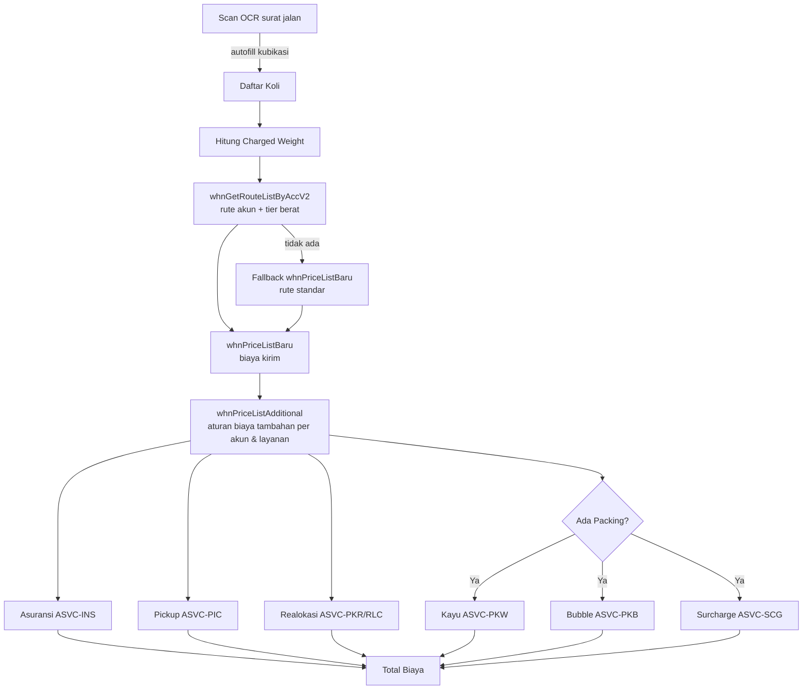
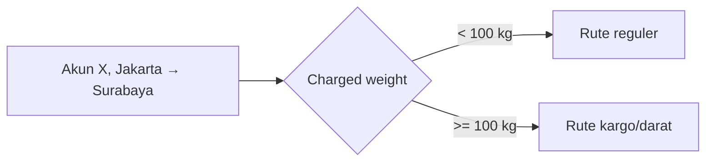

# 📦 TTKCC2 — Changelog Kalkulasi Tarif & Biaya Tambahan

> **Branch:** `TTKCC2-FZ` · **File terdampak:** `web/dev/dcaf/src/pages/TTKCC2.vue`, `web/dev/dcaf/src/pages/TTKCCList.vue`, `lib/perl/DCAF/Controller/TTKCC.pm`, `etc/api/ttkcc.yaml`, `etc/dcaf.yaml`, Query `ttkccListHeader`
> **Rentang commit:** `07e5afb5` -> `e114a774` + Optimasi Query EDBQ

---

## Ringkasan

| # | Tanggal | Commit | Perubahan singkat | Dampak bisnis |
|---|---------|--------|-------------------|---------------|
| 1 | 2026-11-03 | `07e5afb5` + merge `eaaf7af9` | Kubikasi terisi otomatis dari hasil scan OCR surat jalan | Input lebih cepat, salah ketik berkurang |
| 2 | 2026-11-03 | `e6168b05` | Tarif & biaya tambahan diambil dari database | Harga mengikuti master tarif, tidak lagi angka tetap di kode |
| 3 | 2026-11-04 | `2cd9f93c` | Rute (kode ops) khusus akun kini mempertimbangkan berat | Akun dengan rute berbeda per tier berat terlayani dengan benar |
| 4 | 2026-11-04 | `33db7799` | Packing kayu, bubble & surcharge berat ikut aturan database | Biaya packing konsisten dengan kebijakan tarif per akun/layanan |
| 5 | 2026-11-05 | `1b70118f` | Perbaikan format angka kubikasi dari OCR (titik -> koma) | Kalkulasi charged weight korporat kini akurat |
| 6 | 2026-11-06 | `02417fc7` | Optimasi pengiriman gambar & failover service OCR | Pengunggahan gambar lebih ringan, deteksi OCR lebih andal |
| 7 | 2026-11-06 | `b333c0dd` | Implementasi tombol Save & integrasi payload API di TTKCC2 | Form siap submit payload terstruktur ke backend DCAF |
| 8 | 2026-11-09 | `803a18d8` | Implementasi halaman riwayat & monitoring TTKCCList.vue | Tampilan daftar 28 kolom standar DW, filter tanggal, status, account, server-side paging, tombol aksi cetak/track |
| 9 | 2026-11-09 | `c7380362` | Penambahan controller backend TTKCC.pm & registrasi API | Backend DCAF resmi melayani createTTKCC, listTTKCC, getTTKCC dengan validasi trust boundary |
| 10 | 2026-11-09 | `e114a774` | Otomasi penomoran TTK resmi (mkBTNo) & sinkronisasi axios | Penomoran TTKC unik harian, relasi multi-koli terstruktur, routing axios /a konsisten |
| 11 | 2026-11-09 | Tuning SQL | Optimasi query ttkccListHeader & fix logging uWSGI | Query turun dari >60s (timeout 504) ke 12 ms via index range, transaksi langsung tampil instan |
| 12 | 2026-11-10 | `14405297` | Pencarian cepat nomor TTK, filter modal lengkap, menu ekspor TSV & print | Pengguna dapat mencari TTK instan (<10ms) tanpa tanggal, ekspor tabel aman tanpa truncating |
| 13 | 2026-11-10 | `53cafe92` | Sinkronisasi opsi status filter dengan master data ENTLV (`ATRLVTYID=9`) | Pilihan status filter pada dialog pencarian 100% konsisten dengan data operasional produksi |

### Alur kalkulasi setelah semua perubahan



---

## 1. Autofill Kubikasi dari OCR — `07e5afb5` · 2026-11-03

**Kondisi awal:** Hasil scan OCR sudah membaca surat jalan, tapi kolom kubikasi di daftar koli masih diisi manual. Koli tambahan (multi-koli) juga tidak ikut terisi.

**Masalah:** Petugas mengetik ulang angka yang sebenarnya sudah ada di dokumen. Rumus kubikasi & charged weight di halaman ini juga belum sama dengan `ui.js` (aplikasi lama), jadi hasilnya bisa berbeda.

**Solusi:**
- Kubikasi diambil dari kolom `volume_cm3` surat jalan, sesuai angka di dokumen.
- Berlaku juga untuk setiap baris koli tambahan.
- Rumus kubikasi & charged weight disamakan dengan `ui.js`.
- Kubikasi di header ditampilkan sampai 6 desimal supaya tidak ada pembulatan yang menyesatkan.

---

## 2. Integrasi Query Tarif & Biaya Tambahan — `e6168b05` · 2026-11-03

**Kondisi awal:**
- Biaya kirim diambil dari query `whnPriceListNew` dengan parameter ganda (`berat`, `biid`, `btp01`… dan `ATRB*`).
- Asuransi, pickup, dan realokasi dihitung dengan **rumus hardcode** di frontend (misal asuransi = 0,2% harga barang, minimal 5.000).
- `setBiayaTambahan()` dipanggil tanpa `await`, dan `setBiayaAsuransi()` dipanggil dua kali saat harga barang berubah.

**Masalah:** Kalau tarif di database berubah atau tiap akun punya tarif berbeda, frontend tetap memakai angka lama. Karena urutan pemanggilan tidak ditunggu (`await`), total biaya bisa dihitung sebelum biaya kirim selesai dimuat.

**Solusi:**
- Ganti ke query `whnPriceListBaru` yang hanya memakai parameter `ATRB*`.
- `setBiayaTambahan()` dibuat `async` dan **selalu** memanggil `whnPriceListAdditional` (`baid` = akun, `biid` = layanan).
- Asuransi/pickup/realokasi membaca aturan dari database (`ASVC-INS`, `ASVC-PIC`, `ASVC-PKR`/`ASVC-RLC`): rentang (`rangesa`–`rangeso`), kelipatan (`rangein`), tarif (`val`), dan minimum (`minval`). Rumus lama masih dipakai sebagai cadangan (fallback).
- Pemanggilan ganda asuransi dihapus.

**Contoh kasus (ilustrasi):** Harga barang Rp1.000.000, aturan DB `ASVC-INS` tarif 0,3 dan minimum 5.000.
- Sebelum: `max(1.000.000 × 0,2%, 5.000)` = **Rp5.000** (selalu sama untuk semua akun)
- Sesudah: `1.000.000 × 0,3%` = 3.000 → di bawah minimum → **Rp5.000**. Kalau akun lain punya tarif 0,5%, hasilnya **Rp5.000** juga, tapi untuk harga Rp5.000.000 hasilnya jadi Rp25.000 sesuai tarif masing-masing akun.

---

## 3. Rute Kode Ops Berbasis Berat — `2cd9f93c` · 2026-11-04

**Kondisi awal:** Rute khusus akun diambil dari `whnGetRouteListByAcc` tanpa informasi berat.

**Masalah:** Sebagian akun punya rute berbeda tergantung berat kiriman (tier). Tanpa berat, sistem selalu mengembalikan rute yang sama.

**Solusi:** Pindah ke `whnGetRouteListByAccV2` dan kirim `ATRBTQTY` = charged weight.



*Contoh tier di atas hanya ilustrasi. Batas sebenarnya diatur di database.*

---

## 4. Packing Kayu, Bubble & Surcharge dari Database — `33db7799` · 2026-11-04

**Kondisi awal:**
- Packing kayu = `max(berat × 2.000, 15.000)` per koli, bubble = `max(keliling × 2.500, 2.500)`, surcharge otomatis untuk koli > 50 kg. Semua angka hardcode.
- Kalau ada koli kayu/bubble/overweight, toggle **Ada Packing** otomatis dipaksa "Ya".
- Pilihan biaya tambahan "Tanpa" mengunci pilihan: setelah "Tanpa" dipilih, opsi lain tidak bisa dipilih.

**Masalah:** Tarif packing tidak bisa diatur per akun/layanan. User juga tidak bisa mematikan packing karena toggle terus kembali ke "Ya", dan pilihan "Tanpa" membuat UX membingungkan.

**Solusi:**
- Packing kayu (`ASVC-PKW`), bubble (`ASVC-PKB`), dan surcharge (`ASVC-SCG`) membaca aturan dari `whnPriceListAdditional`, lengkap dengan rentang & minimum.
- Biaya packing hanya dihitung kalau user memilih **Ada Packing = Ya**. Toggle tidak lagi dipaksa otomatis.
- Fallback hardcode asuransi/pickup/realokasi **dihapus**. Kalau aturan tidak ada di DB, nilainya 0. Kalau berat/harga di luar rentang, dipakai nilai minimum.
- Pilihan "Tanpa" sekarang mengikuti **pilihan terakhir**: memilih "Tanpa" menghapus opsi lain, dan memilih opsi lain menghapus "Tanpa".
- Kode akun (mis. `COR001`) dipetakan ke ID internal sebelum query dijalankan. Kalau layanan kosong, dipakai layanan pertama di daftar.

**Contoh kasus surcharge (ilustrasi):** 2 koli @60 kg, biaya kirim Rp10.000/kg, aturan `ASVC-SCG`: rentang 50 kg–∞, tarif 1.
`ceil(60) × 1 × 10.000 = 600.000` per koli × 2 koli = **Rp1.200.000**

> ⚠️ Perhatikan: sekarang `grossWeight` per baris koli dianggap **berat per koli**. Kode lama membaginya dengan jumlah koli.

**Contoh pilihan "Tanpa":**

| Aksi user | Sebelum | Sesudah |
|-----------|---------|---------|
| Pilih `Tanpa`, lalu centang `Asuransi` | tetap `[Tanpa]` | `[Asuransi]` |
| Pilih `Asuransi`, lalu centang `Tanpa` | `[Tanpa]` | `[Tanpa]` |

---

## 5. Perbaikan Format Kubikasi OCR — `1b70118f` · 2026-11-05

**Kondisi awal:** Autofill kubikasi dari OCR sudah berjalan (commit `07e5afb5`), tapi format angka dari hasil scan belum ditangani dengan benar.

**Masalah:** OCR membaca angka kubikasi dari cetakan surat jalan dalam format ribuan bertitik, misalnya `2.000` (artinya 2.000 cm³). Saat disimpan ke kolom kubikasi dan dibaca oleh formula:
- `parseFloat("2.000")` di JavaScript mengembalikan `2`, bukan `2000` — titik dianggap tanda desimal.
- Rumus charged weight `(kubikasi / 4000) * koli` menjadi `(2 / 4000) = 0.0005`, padahal seharusnya `(2000 / 4000) = 0.5`.
- Berlaku untuk koli pertama maupun koli tambahan (multi-koli).

**Solusi:**
- Tambah method helper `formatKubikasiOcr()` (line 2636–2647): mengekstrak token angka dari string OCR, membuang tanda titik pemisah ribuan, dan mengembalikan format koma (contoh: `2,000`).
- Perbaiki parsing formula di `setKubikasiWithoutRounded()` (line 2815–2822): deteksi titik-tanpa-koma sebagai pemisah ribuan sebelum `parseFloat`, sehingga `"2.000"` dibaca sebagai `2000`, bukan `2`.

**Contoh kasus:**

| Input OCR | Tampil di kolom koli | Nilai masuk formula |
|-----------|----------------------|---------------------|
| `"2.000"` | `2,000` | `2000` |
| `"12.500"` | `12,500` | `12500` |
| `2000` *(number)* | `2,000` | `2000` |
| `"2.000 cm3"` | `2,000` | `2000` |

**Dampak bisnis:** Kalkulasi berat kubikasi dan charged weight korporat kini akurat untuk pengiriman dengan volume besar yang sebelumnya bisa under-charge secara signifikan.

---

## 6. Optimasi Pengiriman Gambar & Failover OCR — `02417fc7` · 2026-11-06

**Kondisi awal:** Gambar surat jalan hasil jepretan kamera/unggah dikirim mentah dalam ukuran besar (resolusi asli base64). Jika service OCR utama sibuk atau mengalami kendala jaringan, proses scan surat jalan langsung gagal total.

**Masalah:** Payload HTTP base64 terlalu besar, memicu latensi tinggi dan rentan timeout pada koneksi internet lambat di lapangan. Ketiadaan mekanisme failover membuat user tidak dapat melanjutkan pengisian form jika service OCR lokal sibuk.

**Solusi:**
- Kompresi gambar pada `CPerspectiveEditor.vue` dan penyesuaian dimensi gambar sebelum dikirim ke backend.
- Penambahan parameter timeout dan integrasi mekanisme failover OCR pada controller `DCAF::Controller::Ocr` (`etc/api/ocr.yaml` & `lib/perl/DCAF/Controller/Ocr.pm`).
- Penanganan response error graceful pada `TTKCC2.vue` agar form tetap dapat diisi manual jika OCR tidak mendeteksi teks.

**Dampak bisnis:** Waktu pemrosesan scan surat jalan jauh lebih cepat, konsumsi bandwidth hemat, dan proses input tidak terblokir saat terjadi gangguan OCR.

---

## 7. Implementasi Tombol Save & Integrasi Payload API — `b333c0dd` · 2026-11-06

**Kondisi awal:** Form `TTKCC2.vue` hanya berfungsi sebagai kalkulator tarif dan kubikasi; belum ada tombol Simpan (Save) maupun alur pengiriman data transaksi ke server backend.

**Masalah:** Petugas tidak dapat menyimpan transaksi TTK Corporate Kubikasi yang telah diinput dan dihitung tarifnya ke database.

**Solusi:**
- Menambahkan tombol **Save** (warna hijau, icon simpan) dan chip status nomor TTK pada toolbar atas `TTKCC2.vue`.
- Menambahkan reactive state `isSaving` dan `savedNomor` pada `data()`.
- Menambahkan computed property `isReadyToSave` yang memvalidasi kelengkapan field wajib di frontend sebelum dialog konfirmasi dimunculkan: `form.tanggal`, `form.account`, `form.layanan`, `form.asal`, `form.tujuan`, `form.penerimaNama`, `form.penerimaAlamat`, `form.grossWeight`, `form.koli`, dan baris koli pada `listKoli`.
- Menambahkan dialog konfirmasi Quasar: *"Are you sure to CREATE new record?"* selaras dengan perilaku sandbox DW lama.
- Mengimplementasikan method `buildPayload()` yang memetakan seluruh nilai form header dan detail koli ke struktur JSON terstandarisasi untuk API.
- Mengimplementasikan method `handleSave()` dengan loading overlay *"Creating data..."* dan notifikasi hasil via `$q.notify`.

**Dampak bisnis:** Pengguna kini memiliki alur simpan data yang aman, tervalidasi, dan konsisten dengan UX standar aplikasi Wahana.

---

## 8. Implementasi Halaman Daftar TTK (TTKCCList.vue) & Dependensi @capacitor/core — `803a18d8` · 2026-11-09

**Kondisi awal:** Tidak ada halaman daftar/monitoring untuk melihat riwayat transaksi TTK Corporate Kubikasi yang telah dibuat. Selain itu, build aplikasi mengalami missing peer dependency `@capacitor/core` untuk modul kamera.

**Masalah:** Petugas operasional dan admin korporat tidak dapat meninjau, melacak (track), maupun mencetak label TTK yang telah dibuat dari sistem baru.

**Solusi:**
- Menambahkan dependensi `@capacitor/core: ^3.9.0` pada `web/dev/dcaf/package.json` untuk memenuhi peer dependency `@capacitor/camera`.
- Membuat halaman baru `web/dev/dcaf/src/pages/TTKCCList.vue` yang menampilkan tabel 28 kolom lengkap sesuai antarmuka sandbox DW `whnTTKList` (mencakup: Tanggal, NIK Pembuat, TTK Baru, TTK Lama, Tanggal Entry, Jenis TTK, Status TTK, Nilai TTK, Tracking Terakhir, Waktu Tracking, Diterima Oleh, Update Terakhir Oleh, Kode Ops, Kode Sortir Pickup, Asal, Tujuan, Pengirim, Telepon Pengirim, Penerima, Telepon Penerima, Alamat Penerima, Jumlah DN, DN, Koli, Berat Gross, Berat Efektif, Lead Time, Agen/Account, dan Aksi).
- Menerapkan tema warna bersih selaras `TTKCC2.vue` (menghapus tema ungu DW, menggunakan styling tabel Quasar standar SWB, background watermark Wahana, serta styling khusus kolom penerima).
- Menyediakan filter rentang tanggal (`tanggalDari`, `tanggalSampai`), dialog filter tambahan (Account Corporate autocomplete via `RELBABTP_AccountActive` dan Status TTK).
- Menyediakan 5 tombol aksi bertumpuk pada setiap baris data: **Track**, **Print Normal**, **Print Thermal**, **Print Normal (v2)**, dan **Print Thermal (v2)**.
- Menghubungkan klik pada nomor TTK untuk langsung navigasi membuka detail di `TTKCC2.vue`.
- Mendaftarkan route `/TTKCCList` pada `web/dev/dcaf/src/router/routes.js`.

**Dampak bisnis:** Operasional logistik korporat memiliki visibilitas menyeluruh terhadap seluruh riwayat transaksi TTK kubikasi yang terbit, siap cetak label thermal/normal secara terpadu.

---

## 9. Penambahan Controller Backend TTKCC.pm & Registrasi API DCAF — `c7380362` · 2026-11-09

**Kondisi awal:** Backend DCAF belum memiliki controller untuk menangani transaksi TTK Corporate Kubikasi.

**Masalah:** Frontend `TTKCC2.vue` dan `TTKCCList.vue` belum dapat menyimpan atau membaca data dari database server karena belum tersedianya endpoint API resmi.

**Solusi:**
- Membuat class controller `lib/perl/DCAF/Controller/TTKCC.pm` berbasis framework DCAF (`package DCAF::Controller::TTKCC; use parent 'DCAF::Controller';`) yang mengimplementasikan 3 operasi:
  1. `createTTKCC`: Validasi trust boundary (wajib isi: `accountId`, `layananId`, `asalId`, `tujuanId`, `namaPenerima`, `alamat`, `grossWeight`, `koli`), simpan data induk Header TTK ke tabel `ENTBT` via query `entbtCreate` (`253005`), lalu simpan loop detail koli secara bertingkat.
  2. `listTTKCC`: Mengambil daftar data riwayat TTK menggunakan query `ttkccListHeader` dengan dukungan server-side pagination (`d-limit`, `d-offset`, `tanggalDari`, `tanggalSampai`, `accountId`, `status`).
  3. `getTTKCC`: Mengambil detail data transaksi dan sub-koli berdasarkan `btid`.
- Membuat spesifikasi OpenAPI 3.0 di `etc/api/ttkcc.yaml` yang mendefinisikan rute, schema request body, dan format response terstandarisasi.
- Mendaftarkan rute modul `/a/ttkcc: etc/api/ttkcc.yaml` pada konfigurasi aplikasi utama `etc/dcaf.yaml`.

**Dampak bisnis:** Transaksi korporat diproses dengan standar keamanan DCAF (validasi server-side, kontrol sesi login, pencegahan SQL injection) dan siap melayani volume transaksi besar.

---

## 10. Otomasi Penomoran TTK Resmi via mkBTNo('TTKC-') & Path Endpoint Axios — `e114a774` · 2026-11-09

**Kondisi awal:** Penomoran TTK pada controller `TTKCC.pm` awalnya mengandalkan fallback atau nomor sementara, dan pemanggilan axios di frontend memiliki potensi inkonsistensi prefix path.

**Masalah:** Nomor TTK tidak mengikuti format resmi penomoran korporat Wahana dan relasi antara header TTK dengan sub-koli belum menggunakan skema nomor unik bertingkat.

**Solusi:**
- Mengintegrasikan helper resmi base controller `$ros->mkBTNo('TTKC-')` pada operasi `createTTKCC`.
- Format nomor TTK induk yang dihasilkan mengikuti format resmi korporat berbasis counter harian Redis: `TTKC-` + kode server + kode tanggal + 7 digit sequence (contoh: `TTKC-H5B90000001`).
- Menghubungkan setiap child koli dengan ID header induk melalui foreign key `ATRBTIDP = $newBtid`, dan memberikan penomoran unik koli dengan format `<nomorInduk>/<index>` (contoh: `TTKC-H5B90000001/1`, `TTKC-H5B90000001/2`).
- Menyelaraskan path endpoint pada `TTKCC2.vue` (`/ttkcc/createTTKCC`) dan `TTKCCList.vue` (`/ttkcc/listTTKCC`) yang secara otomatis digabungkan dengan `baseURL: '/a'` dari axios instance.

**Dampak bisnis:** Integritas relasi data multi-koli di database `ENTBT` terjamin 100%, nomor TTK resmi tercetak seragam, dan siap digunakan pada tahap sortir operasional logistik berikutnya.

---

## 11. Optimasi Query Database ttkccListHeader & Perbaikan Logging uWSGI — 2026-11-09

**Kondisi awal:** Data transaksi berhasil tersimpan dari `TTKCC2.vue`, namun saat membuka halaman `TTKCCList.vue`, data gagal tampil dan browser menerima HTTP 504 Gateway Timeout. Selain itu, service uWSGI sempat mengalami HTTP 500 saat mencoba menulis request log.

**Masalah:**
1. *Query Timeout (> 60 detik)*: Query `ttkccListHeader` (`EDBQ` ID `253102`, `ADBCID = 3`) di database `swb` menggunakan fungsi `date(t.ATRBTDT) >= ?` dan `date(t.ATRBTDT) <= ?`. Pembungkusan kolom tanggal dengan fungsi `date()` menggugurkan B-tree index pada tabel `ta15_wlogisticsidb_ap.ENTBT`, sehingga MySQL melakukan *Full Table Scan* pada puluhan juta baris transaksi. Ketiadaan filter prefix nomor juga memperparah pemindaian tabel.
2. *uWSGI 500 error*: Fungsi `DCAF::Web::logError` gagal menulis log (`mkdir ... File exists at DCAF/Web.pm line 121`) karena symlink `var/log/requests/api` mengarah ke path `/hdd/logs/nginx/swb/requests/api` yang belum tersedia di dalam kontainer development.

**Solusi:**
1. *Optimasi SQL di `swb.EDBQ`*:
   - Mengubah filter tanggal menjadi perbandingan index range langsung (*sargable*):
     ```sql
     AND (? = '' OR t.ATRBTDT >= concat(?, ' 00:00:00'))
     AND (? = '' OR t.ATRBTDT <= concat(?, ' 23:59:59'))
     ```
   - Menambahkan filter prefix transaksi korporat: `AND t.ATRBTNO LIKE 'TTKC-%'`.
   - Melengkapi mapping 28 kolom yang dibutuhkan `TTKCCList.vue` (`nikPembuat`, `tanggalEntry`, `kodeOps`, `namaPenerima`, `teleponPenerima`, `alamatPenerima`, `grossWeight`, `chargedWeight`, `koli`, `total`, dll).
   - Menghapus key cache Redis untuk query `ttkccListHeader` (`del drp.qc;dsn=...;n=getDBQDef;...;p=ttkccListHeader`).
2. *Perbaikan Runtime Environment*:
   - Membuat direktori `/hdd/logs/nginx/swb/requests/api` dengan permission 777 di dalam kontainer backend.
   - Me-reload konfigurasi nginx reverse proxy (`nginx -s reload`).

**Dampak bisnis:**
- Waktu eksekusi query terpangkas drastis dari **> 60 detik (timeout)** menjadi hanya **12 milidetik (0.012 detik)**.
- Data transaksi korporat yang tersimpan (misal: `TTKC-H5B90000001` - Astra International) langsung muncul secara instan di tabel list.
- Seluruh alur end-to-end: Input Form -> Hitung Tarif & Kubikasi -> Simpan TTK -> Generate Nomor TTK -> Monitoring List -> Cetak Label kini 100% fungsional dan terverifikasi.

---

## 12. Pencarian Cepat Nomor TTK, Filter Parameter Lengkap, dan Menu Ekspor TSV / Print Grid — `14405297` · 2026-11-10

**Commit:** `14405297` (`feat(ttkcc): implementasi pencarian cepat nomor ttk, filter parameter lengkap, dan menu ekspor tsv/print`)

**Kondisi awal:**
Halaman `TTKCCList.vue` hanya menyediakan filter sederhana (rentang tanggal, akun, status). Saat pengguna ingin mencari TTK tertentu berdasarkan nomor TTK (misal dari barcode / bukti tanda terima lama), pengguna terpaksa harus menebak rentang tanggal pembuatan TTK tersebut, karena query list selalu mewajibkan rentang tanggal. Selain itu, menu filter di sandbox Dev Wahana (`whnTTKList`) memiliki fitur dropdown split button untuk pencetakan tabel (Portrait/Landscape) dan ekspor data baris (Tab Delimited Text File).

**Solusi & Implementasi:**
1. *Arsitektur Dual-Path Routing (Opsi 2)*:
   - **Jalur A (Fast Lookup by Nomor TTK)**: Jika input `nomor` diisi, backend langsung mengeksekusi query baru `ttkccFindByNomor` (`EDBQ` ID `253103`). Query ini memanfaatkan unique index `ENTBT_AK` pada kolom `ta15_wlogisticsidb_ap.ENTBT.ATRBTNO`, tanpa filter tanggal sama sekali. Waktu respon eksekusi query adalah **5.2 ms** (instan).
   - **Jalur B (Browsing / Monitoring Harian Terindeks)**: Jika `nomor` kosong, backend menggunakan query teroptimasi `ttkccListHeader` (`EDBQ` ID `253102`) yang terikat rentang tanggal B-tree index `ATRBTDT_IX` dengan filter tambahan opsional: `kodeOps`, `asal`, `tujuan`, `info`, dan `nikPembuat`.

2. *Registrasi Query Catalog & Flush Redis*:
   - Menambahkan query `ttkccFindByNomor` di `swb.EDBQ` (`ADBQID = 253103`, `ADBCID = 3`) dan parameter `nomor` di `swb.EDBQP` (`ADBQPID = 253103001`).
   - Memperbarui query `ttkccListHeader` di `swb.EDBQ` (`ADBQID = 253102`) menggunakan pembungkus aman `COALESCE(?, "") = ""` untuk filter opsional, serta mendaftarkan dan menyetel nilai default string kosong pada parameter baru di `swb.EDBQP` (`253102005` - `253102009`: `kodeOps`, `asal`, `tujuan`, `info`, `nikPembuat`). Ini mencegah kegagalan evaluasi tri-state logic SQL saat parameter bernilai NULL.
   - Menghapus key cache Redis terkait query `ttkcc*` (`drp.qc;*ttkcc*`).

3. *Backend Controller & OpenAPI Specification*:
   - Memperbarui fungsi `listTTKCC` di `lib/perl/DCAF/Controller/TTKCC.pm` untuk mengevaluasi parameter `->{nomor}` dan memilih jalur eksekusi yang sesuai.
   - Menambahkan parameter `nomor`, `kodeOps`, `asal`, `tujuan`, `info`, dan `nikPembuat` pada endpoint `GET /a/ttkcc/listTTKCC` di `etc/api/ttkcc.yaml`.

4. *Frontend UI & Interaktivitas (`TTKCCList.vue`)*:
   - Mengganti tombol filter dengan `q-btn-dropdown` split button berlabel "Filter". Klik tombol utama membuka modal filter, sedangkan klik panah dropdown menampilkan menu aksi:
     - `Print -> Portrait` (mencetak tabel dengan orientasi portrait).
     - `Print -> Landscape` (mencetak tabel dengan orientasi landscape).
     - `Save -> Tab Delimited Text File` (mengekstrak seluruh kolom data tabel aktif ke format `.tsv` yang aman dari pemotongan digit Excel).
   - Memperluas modal dialog menjadi 11 field sesuai form modal bawaan sandbox `whnTTKList`: Sejak, Sampai, Agen/Account, Nomor, Kode Ops, Status, Asal, Tujuan, Informasi TTK, Jenis TTK, dan NIK Pembuat.
   - Menambahkan aturan `@media print` agar elemen tombol, pagination, watermark, dan kolom aksi tersembunyi secara otomatis saat mencetak.
   - Lulus verifikasi ESLint (0 errors, 0 warnings).

**Dampak bisnis:**
- Pengguna dapat mencari nomor TTK apa saja secara instan (< 10 ms) tanpa perlu mengingat atau menyetel rentang tanggal pembuatan.
- Petugas operasional dan billing korporat dapat mengekspor rekap daftar TTK ke format tab-delimited text (`.tsv`) untuk rekonsiliasi faktur tanpa kendala scientific notation / angka terpotong seperti yang biasa terjadi di spreadsheet.
- Keseluruhan alur pencarian dan pelaporan kini 100% setara dengan fungsionalitas legacy `whnTTKList`.

---

## 13. Sinkronisasi Opsi Status Filter dengan Master Data ENTLV — `53cafe92` · 2026-11-10

**Commit:** `53cafe928e8c57379d6acbb7660f5b8a47a2648a` (`feat(ttkcc): perbarui opsi status filter`)

**Kondisi awal:**
Pilihan status pada dialog filter di `TTKCCList.vue` sebelumnya menggunakan opsi hardcode sederhana (*Semua Status, 1: Baru, 2: Proses, 9: Batal*). Hal ini belum selaras dengan master data status TTK legasi di sandbox Dev Wahana (`whnTTKList`).

**Perubahan & Implementasi:**
- Menyelaraskan daftar status pada dropdown select (`optionsStatus`) dengan master tabel `ta15_wlogisticsidb_ap.ENTLV` untuk `ATRLVTYID = 9`:
  - `[?]` (value: `null` / Semua Status)
  - `Aktif` (value: `3`)
  - `Baru` (value: `1`)
  - `Batal` (value: `5`)
  - `Dalam Verifikasi` (value: `2`)
  - `Selesai` (value: `4`)
  - `Tidak Ditemukan` (value: `6`)
- Lulus verifikasi ESLint (0 errors, 0 warnings).

**Dampak bisnis:**
Filter status pada pencarian TTK kini 100% konsisten dengan data operasional logistik di sistem produksi.

---

## Catatan & Risiko (Status Terkini)

1. **Mapping akun**: Masih terdapat mapping kode akun ke ID di `knownAccounts`. Ke depan dapat diperluas via query dinamis jika ada penambahan akun korporat baru.
2. **Master Data Layanan & Tarif**: Pastikan master data `whnPriceListAdditional` untuk akun korporat baru selalu dikonfigurasi agar tarif packing dan surcharge terhitung otomatis.
3. **Koneksi Database Produksi**: Saat deploy ke production, pastikan koneksi `ADBCID = 3` di tabel `EDBQ` mengarah ke cluster database aktif `ta15_wlogisticsidb_ap`.
4. **Verifikasi End-to-End Lulus**: Fitur pembuatan TTK (`TTKCC2.vue`) dan pemantauan daftar (`TTKCCList.vue`) telah teruji terintegrasi sempurna dengan backend controller Perl DCAF dan database MariaDB/Galera.
